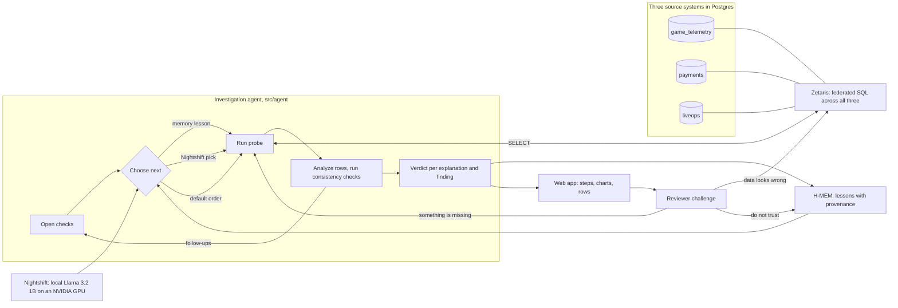

# LiveOps Investigator

**An agent that explains why a live event made less money, by following evidence across the game server, the payment gateway and the live-ops calendar, and lets people challenge every step.**

Local prototype for Open Agent Hackathon 2026, track **The Agent That Can Explain Why**.

## The problem

More trainers showed up for Community Day, but the event made less money. A live-ops team has to explain that before the next event, and the answer is spread across systems that do not talk to each other: player and order data on the game server, success and error codes at the payment gateway, prices and app releases in the live-ops calendar. A dashboard shows the drop; it does not say why.

LiveOps Investigator queries all three sources through Zetaris, drills down step by step (each result decides which checks open next), and gives each possible explanation a verdict with the steps behind it. Every number on the page links back to the SQL and rows Zetaris returned, and a reviewer can dispute a value, ask for another comparison, or reject a finding.

## The scenario and the data

The scenario follows Pokémon GO's public Community Day format: a monthly three-hour event, a paid Special Research ticket (US$1.99, with a later event at US$4.99), a Community Day Box on the Web Store (US$4.99), and PokéCoin packs (550 coins for US$4.99 up to 14,500 for US$99.99), bought through the App Store, Google Play or the Web Store. Sources: official Pokémon GO event pages such as [Community Day, November 2025](https://pokemongo.com/news/communityday-november-2025-pikipek) and [December 2025](https://pokemongo.com/news/community-day-december-2025), and the [Web Store launch](https://pokemongo.com/news/pokemon-go-web-store-global-launch).

**Every player, order and payment record is synthetic.** `src/data/generate.ts` produces them with a fixed seed, so the same rows come out every time; nothing here is the game operator's or any real game's data, and the build numbers and release notes are invented. The behaviour model is written out in that file, including the two problems planted for the agent to find:

- **Community Day 2:** Android build 0.393.1, released two days earlier with a Google Play Billing Library upgrade, makes most Google Play purchases fail with `BILLING_UNAVAILABLE`.
- **Community Day 4:** the ticket price rises from US$1.99 to US$4.99, and the Web Store box no longer contains the ticket.

The data lives in three Postgres databases, each registered in Zetaris as its own datasource:

| Zetaris datasource | Source system | Tables (rows) |
| --- | --- | --- |
| `game_telemetry` | Game server | `players` (95,000), `event_participation` (201,000), `store_orders` (43,422) |
| `payments` | Payment gateway | `payment_attempts` (45,345), with Google Play, App Store and Web Store response codes |
| `liveops` | Live-ops config | `events` (4), `offers` (28), `releases` (9) |

## Two cases

| Case | Symptom | What the agent found |
| --- | --- | --- |
| Community Day 1 → 2 | Participants 42,000 → 55,000; revenue $42,498 → $39,387 | Google Play order success 94.3% → 40.6%; build 0.393.1 completes 28.9% of orders; its top failure is `BILLING_UNAVAILABLE` (54.8% of failed attempts, 0% on other builds); the build shipped 2026-02-12 with a billing library upgrade. A shift toward returning players also lowers revenue per participant by 6.7%. |
| Community Day 3 → 4 | Participants 47,000 → 57,000; revenue $49,926 → $40,027 | Payments healthy in every store. Ticket revenue $18,845 → $11,193 and box revenue $7,909 → $2,715; the ticket price rose to $4.99 and the box lost the ticket; the share of active players buying the ticket fell from 23.7% to 4.9%, and it fell in every segment, so the player mix does not explain it. |

Case two recalls case one's lesson from H-MEM ("the lead first appeared in payment success by store"), so it checks payments first, finds them healthy, and moves on. The numbers above come from the data and do not change between runs; the order of steps can, because Nightshift chooses among open checks.

## Architecture



The agent can only run reviewed SQL templates (`src/agent/probes.ts`). Parameters come from the case definition or from an earlier probe's validated result, never from model text, and are checked against a safe character set. Each probe's analysis returns the follow-up checks it justifies, for example a store whose success fell by more than five points opens "payment success by app version" for that store. When several checks are open, a recalled H-MEM lesson picks first, then Nightshift's choice if it names a valid candidate, then the first candidate. Every open check still runs, so these choices change the path and how soon the lead appears, not which evidence is collected. Cross-source consistency checks (product revenue adds up to the overview; completed orders in the game equal OK attempts in the payment log; segment totals equal participants) stop the run if they fail.

## Requirements

- Node.js 22+ (tested with 24.14.0) and npm; Docker.
- A running, licensed Zetaris deployment with its web API available locally (tested with 2.4.3.1 running in Docker as `liveops-zetaris_*`). Obtain the software and credentials through [Zetaris](https://github.com/zetaris/getting-started); proprietary installers and credentials are not included.
- A running [Nightshift](https://meterless.ai/windows.html) installation with a local model ready. Tested with Nightshift 1.2.7, `meterless/local`, and Llama 3.2 1B Instruct.
- Windows is the tested environment. H-MEM is vendored and needs no separate service.

## Quick start

```powershell
npm ci
Copy-Item .env.example .env.local
# Edit .env.local: your Zetaris login, and a GAMEDATA_PG_PASSWORD of your choice.
# Do not overwrite an existing configured .env.local.
docker compose --env-file .env.local -f docker/gamedata.compose.yml up -d   # Postgres on the Zetaris network
npm run data:setup          # generate the data, load it, register the three datasources in Zetaris
npm test
npm run verify -- --chat    # connectivity: H-MEM, Zetaris, Nightshift
npm run app                 # web app at http://127.0.0.1:4317/
```

On Windows, **Run-App.cmd** starts the web app and opens the browser. `npm run demo` runs the same investigation in the terminal and writes `reports/<run>.json`.

| Variable | Purpose |
| --- | --- |
| `ZETARIS_BASE_URL` | Web origin, such as `http://127.0.0.1:3000` |
| `ZETARIS_USERNAME`, `ZETARIS_PASSWORD` | Your local deployment login (an administrator is needed to register datasources) |
| `GAMEDATA_PG_PASSWORD` | Password for the local game-data Postgres and its read-only Zetaris user |
| `NIGHTSHIFT_BASE_URL` | Local provider, default `http://127.0.0.1:8088/v1` |
| `NIGHTSHIFT_MODEL` | Routing mode; example defaults to `meterless/local` |
| `NIGHTSHIFT_TOKEN` | Optional override; Windows otherwise reads the current user's runtime `proxy-token` file |

H-MEM persistence is under `.state/replays/<run timestamp>`. Each run starts a fresh replay, so case two can learn only from case one, never from an earlier run.

## Use the web app

Click **Run the investigation** and the progress panel fills in step by step. Each case then shows:

1. **The finding**, generated from the collected metrics, and a verdict for each explanation (payment failures, a changed offer, a shift in the player mix) with links to the steps behind it.
2. **Memory and path:** the H-MEM lessons recalled, how the next check was chosen, and the step where the lead first appeared, against the step the default order would have reached it.
3. **Every step:** its question, why it ran (which result opened it and who picked it), the data sources it joined, a chart, its conclusion, and the SQL with the rows Zetaris returned.

Challenges are recorded per run in `reports/<run>.reviews.json`:

| Challenge | What the agent does |
| --- | --- |
| The data looks wrong (on a step, or on one value in its rows) | Re-runs that step's SQL on Zetaris and reports whether the sources still return the recorded rows. Everything that rests on the step is marked "data disputed". |
| Something is missing | Runs a check the case has not run, such as revenue by country or payment success by version for another store, as a new Zetaris query with the same consistency checks. |
| I don't trust this | Marks the finding disputed and calls H-MEM `feedback(id, 'wrong')` on the lesson stored for that case, which lowers its confidence by 0.2, tags it `review`, and logs the change in the H-MEM ledger. |

A challenged finding stays flagged until its reviews are marked resolved. The server listens only on `127.0.0.1`, rejects requests from other origins, and refuses to be framed.

## Sponsor technology

- **Zetaris** is the data layer and the reason the agent can work across systems: the three source databases are registered as Zetaris datasources (`CREATE DATASOURCE`, `REGISTER DATASOURCE TABLES`), and the agent's probes are single SQL statements that join them, for example store orders from `game_telemetry` with payment attempts from `payments` and offer prices from `liveops`.
- **Meterless Nightshift** is the AI provider. At each decision point the agent sends the findings so far and the open checks to the local OpenAI-compatible endpoint; a reply that names a valid check chooses the next step, and every raw reply is kept with the step.
- **Meterless H-MEM** is the memory engine. A solved case stores a lesson with provenance (which check surfaced the lead); the next case recalls it from disk and tries that check first. When a reviewer rejects a finding, H-MEM's feedback API lowers the lesson's confidence and records the change in its ledger.
- **NVIDIA:** the local model, Llama 3.2 1B Instruct, runs under Nightshift on an NVIDIA RTX 4060 Laptop GPU through CUDA. NVIDIA Nemotron is not used.
- **Cursor** was used as the code editor during development. It is not part of the running workflow.
- **What is distinctive:** the agent's path is visible and contestable. Each step says which earlier result opened it and who chose it, memory changes where it looks first without being taken as the answer, and a reviewer's challenge is answered with a new query rather than a restated claim.

Pre-existing components: the vendored H-MEM reference implementation. The first project commit is dated 2026-10-26, inside the build window.

## Validation and limitations

Twenty automated tests cover the data generator (determinism; every completed order has exactly one OK payment attempt; order prices match the live-ops offers; both cases show more players and less revenue), the probes (strict cell parsing, the five-point threshold, unsafe parameters refused, follow-ups only where justified, the cross-source check), the agent loop (every open check runs; memory outranks the model and the model outranks the default; a failed consistency check stops the run; verdicts depend only on collected evidence), challenge validation and status, and the Nightshift and endpoint adapters. Both cases have also completed with actual Zetaris, Nightshift and H-MEM calls on the development machine; `npm run verify -- --chat` and `npm run app` check that for your setup.

The planted causes are known in advance; the cases show that the agent's checks find them from the data, not that it would find an unknown cause in production. The verdict rules (a drop of more than five percentage points, a product losing more than 10% of its revenue, a mix effect beyond 5%) are demonstration thresholds, not significance tests. A 1B model chooses the order of checks; it often picks the first option it reads, and it never writes SQL, states a number or gives a verdict. Findings point to where to look next; they do not prove a cause. No production root cause, automated remediation, arbitrary natural-language querying, or causal inference is claimed.

## Repository map

- `src/app.ts`, `web/`: local web app (server, page, charts)
- `src/agent/probes.ts`: the SQL checks and their analyses; `src/agent/investigate.ts`: the agent loop and verdicts
- `src/pipeline.ts`: both cases end to end, with H-MEM and Nightshift; `src/workflow.ts`: terminal entry point
- `src/data/`: the live-ops catalog and the synthetic data generator; `src/setup-data.ts`: load and register the datasources
- `src/review.ts`, `src/review-actions.ts`: reviewer challenges and the agent's follow-up queries
- `src/providers.ts`: Zetaris and Nightshift adapters; `docker/gamedata.compose.yml`: the game-data Postgres
- `vendor/hmem/`: upstream H-MEM reference and license
- `docs/`: project description, demo script, release checklist

## License and attribution

Original project code is released under the MIT License; see `LICENSE`. H-MEM source is from [Meterless/Meterless](https://github.com/Meterless/Meterless), commit `1742dec56a66e58eef9dda2d2b865823758ca8cd`, path `engines/hmem/reference/src`; it remains under the Apache License 2.0 in `vendor/hmem/LICENSE`. Zetaris and Nightshift are external products and are not redistributed here. Pokémon GO is a trademark of its owners; this project is not affiliated with or endorsed by them, and it uses only the publicly described event format and list prices.

Local credentials, private notes, runtime memory, generated reports, dependencies, and installers are excluded from Git. Do not upload local `.env` files or registry credentials.
