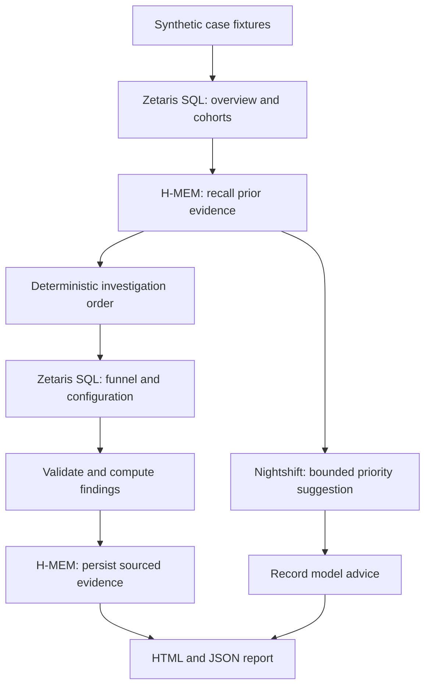

# LiveOps Investigator

**Investigate a game revenue drop with queryable evidence, bounded model advice, and memory that is checked against new facts.**

Local prototype for Open Agent Hackathon 2026. Suggested track: **The Agent That Can Explain Why**. This repository preparation does not publish or submit the project.

## What it does

More players does not always mean more revenue. LiveOps Investigator runs two synthetic game-event investigations through real local services:

1. Query overview metrics and player cohorts through Zetaris.
2. Recall prior evidence from the official H-MEM TypeScript reference implementation.
3. Ask Nightshift for a constrained investigation-order suggestion.
4. Query payment funnels and event configuration through Zetaris.
5. Validate counts and compute evidence-based hypothesis checks.
6. Persist attributed evidence, reopen memory, and generate an auditable HTML report.

The current workflow uses deterministic routing and calculations. Nightshift advises on priorities; it does not generate SQL, control execution, or establish causality. No successful result is fabricated when a service fails.

## Two cases

| Case | Observations | Supported next investigation |
| --- | --- | --- |
| Payment incident | Participants 1,000 → 1,500; revenue 1,000 → 900; payment success 80% → 60%; configuration unchanged | Inspect payment errors and device/version segments |
| Offer regression | Participants 1,500 → 1,800; revenue 1,200 → 800; payment success remains 80%; reward units 100 → 60 | Investigate offer changes and validate with a controlled comparison |

Case two recalls case one and checks payments first. Fresh evidence rejects a repeat payment-success decline. This demonstrates memory-guided investigation without blindly copying a historical conclusion. Both checks always run; no latency or query-count improvement is claimed.

## Architecture



## Requirements

- Node.js 22+ (tested with 24.14.0) and npm.
- A running, licensed Zetaris deployment with its web API available locally. Obtain the software and credentials through [Zetaris](https://github.com/zetaris/getting-started); proprietary installers and credentials are not included.
- A running [Nightshift](https://meterless.ai/windows.html) installation with a local model ready. Tested with Nightshift 1.2.7, `meterless/local`, and Llama 3.2 1B Instruct.
- Windows is the tested environment. H-MEM is vendored and needs no separate service.

## Quick start

```powershell
npm ci
Copy-Item .env.example .env.local
# Edit .env.local with your own local Zetaris credentials.
# Do not overwrite an existing configured .env.local.
npm test
npm run verify -- --chat
npm run demo
```

Open `reports/demo.html` after success. On Windows, double-click **Run-Demo.cmd** to run the workflow and open the report automatically. The launcher expects dependencies and services to be ready; it does not install or start them.

Configuration:

| Variable | Purpose |
| --- | --- |
| `ZETARIS_BASE_URL` | Web origin, such as `http://127.0.0.1:3000` |
| `ZETARIS_USERNAME`, `ZETARIS_PASSWORD` | Your local deployment login |
| `ZETARIS_API_KEY`, `ZETARIS_ORG_ID` | Alternative token and organization authentication |
| `NIGHTSHIFT_BASE_URL` | Local provider, default `http://127.0.0.1:8088/v1` |
| `NIGHTSHIFT_MODEL` | Routing mode; example defaults to `meterless/local` |
| `NIGHTSHIFT_TOKEN` | Optional override; Windows otherwise reads the current user's runtime `proxy-token` file |

Login credentials take precedence over the token alternative. H-MEM persistence is under `.state/replays/<run timestamp>`. Each demo starts a fresh replay; case two reopens the same store created by case one. This avoids contamination by future cases from earlier replays.

## Inspect the evidence

The report includes each executed SQL statement, returned rows, timing, model routing suggestion, memory provenance, and deterministic findings. Its current presentation is bilingual/Chinese; this README and the narration script are English.

Fixtures are SQL CTEs evaluated by Zetaris, not production tables or persistent data-source integrations. Counts assume at most one purchase attempt per player per period. Payment successes must equal payers, and cohort totals must reconcile with overview metrics. A decline exceeding five percentage points flags a payment-success issue; this is a demonstration rule, not a significance test.

## Validation and limitations

Twelve automated tests cover metric handling, rejection of blank, non-numeric, or version-less evidence, cohort and payment-count reconciliation, the memory-routing rule, endpoint normalization, and authentication behavior. Both cases have also completed with actual Zetaris, Nightshift, and H-MEM calls on the development machine. Tests alone do not establish live-service availability; use `npm run verify -- --chat` and `npm run demo` for that.

A 1B model produced incorrect metric explanations during development. Consequently, model output is constrained to two allowed priority IDs and is validated; numerical findings come from code. Invalid model output fails the run. Model suggestions are advisory, and the supplied examples do not establish general model quality.

Configuration changes can coincide with conversion changes without causing them. No production root cause, automated remediation, arbitrary natural-language querying, or causal inference is claimed. Service failures produce a nonzero exit code; an existing report may remain, so check its timestamp.

## Repository map

- `src/workflow.ts`: current two-case orchestration
- `src/cases.ts`: fixtures, SQL, validation, and memory routing
- `src/providers.ts`: Zetaris and Nightshift adapters
- `src/workflow-report.ts`: report renderer
- `src/*.test.ts`: automated tests
- `vendor/hmem/`: upstream H-MEM reference and license
- `docs/PROJECT-INTRO.md`: submission description and project positioning
- `docs/DEMO-SCRIPT.md`: timed English video script
- `docs/RELEASE-CHECKLIST.md`: preparation and remaining manual steps

Legacy single-case code remains available through `npm run demo:legacy`.

## Attribution and privacy

H-MEM source is from [Meterless/Meterless](https://github.com/Meterless/Meterless), commit `1742dec56a66e58eef9dda2d2b865823758ca8cd`; its license is preserved in `vendor/hmem/LICENSE`. Zetaris and Nightshift are external products and are not redistributed here. No additional license grant is made for original project code in this preparation.

Local credentials, private notes, runtime memory, generated reports, dependencies, and installers are excluded from Git. Do not upload local `.env` files or registry credentials. Publishing the repository and submitting the competition entry are separate actions that have not been performed.
