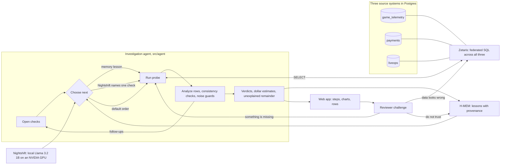

# LiveOps Investigator

**An agent that explains why a live event earned less than its turnout predicted: it follows the evidence across the game server, the store purchase log and the live-ops calendar, sizes each explanation in dollars, says what it cannot explain, and lets people challenge every step.**

Local prototype for Open Agent Hackathon 2026, track **The Agent That Can Explain Why**.

## The problem

More trainers showed up for Community Day, but revenue did not keep up. A live-ops team has to explain that before the next event, and the answer is spread across systems that do not talk to each other: players and orders on the game server, billing results in the store purchase log, prices and app releases in the live-ops calendar. A dashboard shows the gap; it does not say why, or how much of it each cause explains.

LiveOps Investigator queries all three sources through Zetaris and drills down step by step: each result decides which checks open next. Each explanation it checks gets a verdict, a dollar estimate and the steps behind it, and the part no check explains is reported instead of being pinned on something. Every step shows the SQL and the rows Zetaris returned, and a reviewer can dispute a value, ask for another comparison, or reject a finding.

## The scenario and the data

The scenario follows Pokémon GO's public Community Day format: a monthly three-hour event, a paid Special Research ticket (US$1.99, with a later event at US$4.99), a Community Day Box on the Web Store (US$4.99), and PokéCoin packs (100 coins for US$0.99 up to 14,500 for US$99.99), bought through the App Store, Google Play or the Web Store. Sources: official Pokémon GO event pages such as [Community Day, November 2025](https://pokemongo.com/news/communityday-november-2025-pikipek) and [December 2025](https://pokemongo.com/news/community-day-december-2025), and the [Web Store launch](https://pokemongo.com/news/pokemon-go-web-store-global-launch).

**Every player, order and payment record is synthetic.** `src/data/generate.ts` produces them with a fixed seed (chosen from 60 tried, 49 of which make revenue fall in all three cases); nothing here is the game operator's or any real game's data, and the build numbers and release notes are invented. The behaviour model is written out in that file:

- Segments follow their definitions: **new** installed in the 30 days before the event, **active** took part in the previous Community Day, everyone else is **returning**.
- Spending is long-tailed (the top tenth of payers bring more than half the revenue), with repeat purchases, country-level spend and platform shares, and purchases concentrated in the three-hour window.
- Store billing results (Google Play `BillingResponseCode`, StoreKit `SKError`) are reported by the game client; Web Store attempts carry payment-provider responses. Some buyers whose app-store purchase fails switch to the Web Store.

Three problems are built into the data. The agent is never told any of them, and nothing it sees names them:

- **Community Day 2:** Android build 0.393.1, rolled out in stages two days earlier with a Google Play Billing Library upgrade, makes most Google Play purchases on that build fail with `BILLING_UNAVAILABLE`. A harmless change also happens: the box gains an Incubator.
- **Community Day 4:** the ticket price rises from US$1.99 to US$4.99, and the Web Store box no longer contains the ticket.
- **Community Day 5:** players spend less on everything, for a reason none of the sources records. No check can find it; the right answer is "not explained".

The data lives in three Postgres databases, each registered in Zetaris as its own datasource:

| Zetaris datasource | Source system | Tables (rows) |
| --- | --- | --- |
| `game_telemetry` | Game server | `players` (113,000), `event_participation` (207,684), `store_orders` (35,760) |
| `payments` | Store purchase log | `payment_attempts` (36,691): store billing results from the game client, Web Store provider responses |
| `liveops` | Live-ops config | `events` (5), `offers` (40), `releases` (11) |

## Three cases

The agent compares revenue with what the turnout predicted (participants × the earlier revenue per participant) and investigates when it falls more than 5% short.

| Case | Turnout and revenue | Shortfall | What the agent found |
| --- | --- | --- | --- |
| Community Day 1 → 2 | 34,614 → 43,042 players; $38,334 → $35,286 | $12,382 | Google Play order completion 93.8% → 67.6%; build 0.393.1 completes 47.7% of its orders; its top failure is `BILLING_UNAVAILABLE` (60.6% of failed attempts, 0% on other builds); the build shipped 47 hours before the event ended. About $4,943 is failed Google Play orders and about $7,250 the shift toward returning players, who spend less. The box change is named and dismissed. |
| Community Day 3 → 4 | 38,039 → 44,577 players; $43,458 → $37,457 | $13,471 | Payments healthy. The ticket price rose to $4.99 and the box lost the ticket; the share of active players buying the ticket fell from 14.8% to 4.7%, and buyers fell in every segment with enough buyers to compare. About $3,911 is the changed offer, about $6,013 the player mix, and $3,547 is unexplained. |
| Community Day 4 → 5 | 44,577 → 47,412 players; $37,457 → $33,611 | $6,228 | Payments held, no offer changed, and the player mix even added $1,427. None of the checked explanations accounts for the shortfall; all $6,228 is reported as unexplained, possibly normal variation or a cause that needs data the prototype does not have. |

Cases two and three recall earlier lessons from H-MEM and check payments first; fresh data rules payments out each time. The numbers above come from the data and do not change between runs; the order of steps can, because Nightshift chooses among open checks.

## Architecture



The agent can only run reviewed SQL templates (`src/agent/probes.ts`). Parameters come from the case definition or from an earlier probe's validated result, never from model text, and are checked against a safe character set. Each probe's analysis returns the follow-up checks it justifies: a store whose completion rate fell by more than five points, on at least 200 orders and beyond a two-proportion z-test of |z| ≥ 3, opens "revenue lost to failed orders" and "order completion by app build" for that store. "Revenue lost to failed orders" is one SQL statement that joins all three sources: orders from `game_telemetry`, attempt results from `payments`, list prices from `liveops`.

When several checks are open, a recalled H-MEM lesson picks first (lessons marked wrong are skipped), then Nightshift's choice if its reply names exactly one valid candidate, then the first candidate. Every open check still runs, so these choices change the path and how soon the lead appears, not which evidence is collected. Cross-source consistency checks stop the run if they fail: the overview's three-part split adds up to the revenue change, product revenue adds up to the overview, completed orders in the game equal OK attempts in the purchase log, paid value in the log equals completed revenue, segment totals equal participants.

## Requirements

- Node.js 22+ (tested with 24.14.0) and npm; Docker.
- A running, licensed Zetaris deployment, in Docker on the same host, with its web API available locally (tested with 2.4.3.1) and an administrator login (registering datasources needs one). Obtain the software and credentials through [Zetaris](https://github.com/zetaris/getting-started); proprietary installers and credentials are not included.
- A running [Nightshift](https://meterless.ai/windows.html) installation with a local model ready. Tested with Nightshift 1.2.7, `meterless/local`, and Llama 3.2 1B Instruct.
- Windows is the tested environment. H-MEM is vendored and needs no separate service.

## Quick start

```powershell
npm ci
Copy-Item .env.example .env.local
# Edit .env.local: your Zetaris login, GAMEDATA_PG_PASSWORD (12+ letters, digits, _ or -),
# and ZETARIS_DOCKER_NETWORK (find it with `docker network ls`).
# Do not overwrite an existing configured .env.local.
docker compose --env-file .env.local -f docker/gamedata.compose.yml up -d   # Postgres on the Zetaris network
npm run data:setup          # generate the data, load it, register the three datasources in Zetaris
npm test
npm run verify -- --chat    # connectivity: H-MEM, Zetaris, Nightshift
npm run app                 # web app at http://127.0.0.1:4317/
```

On Windows, **Run-App.cmd** starts the web app and opens the browser. `npm run demo` runs the same investigation in the terminal and writes `reports/<run>.json`. `npm run data:setup` refuses to replace a Zetaris datasource with the same name that it did not create, unless run with `--force`.

| Variable | Purpose |
| --- | --- |
| `ZETARIS_BASE_URL` | Web origin, such as `http://127.0.0.1:3000` |
| `ZETARIS_USERNAME`, `ZETARIS_PASSWORD` | Your local deployment login (an administrator, to register datasources) |
| `ZETARIS_API_KEY`, `ZETARIS_ORG_ID` | Alternative token and organization authentication for queries |
| `ZETARIS_DOCKER_NETWORK` | Docker network of your Zetaris deployment, default `liveops-zetaris_default` |
| `GAMEDATA_PG_PASSWORD` | Password for the local game-data Postgres and its read-only Zetaris user |
| `NIGHTSHIFT_BASE_URL` | Local provider, default `http://127.0.0.1:8088/v1` |
| `NIGHTSHIFT_MODEL` | Routing mode; example defaults to `meterless/local` |
| `NIGHTSHIFT_TOKEN` | Optional override; Windows otherwise reads the current user's runtime `proxy-token` file |
| `APP_PORT` | Web app port, default 4317 |

H-MEM persistence is under `.state/replays/<run timestamp>`. Each run starts a fresh replay, so a case can learn only from the cases before it, never from an earlier run.

## Use the web app

Click **Run the investigation** and the progress panel fills in step by step. Each case then shows:

1. **The finding**, generated from the collected metrics: the shortfall against the turnout, each supported explanation with a dollar estimate, and what is left unexplained. A verdict table links each explanation to the steps behind it.
2. **Memory and path:** the H-MEM lessons recalled, how the next check was chosen, and the step where the lead first appeared, against the step the default order would have reached it.
3. **Every step:** its question, why it ran (which result opened it and who picked it, including the model name), the data sources it joined, a chart, its conclusion, and the SQL with the rows Zetaris returned.

Challenges are recorded per run in `reports/<run>.reviews.json`:

| Challenge | What the agent does |
| --- | --- |
| The data looks wrong (on a step, or on one value in its rows) | Re-runs that step's SQL on Zetaris and reports whether the sources still return the recorded rows. Everything that rests on the step is marked "data disputed". |
| Something is missing | Runs a check the case has not run, such as revenue by country or order completion by build for another store, as a new Zetaris query with the same consistency checks. |
| I don't trust this | Marks the finding disputed and calls H-MEM `feedback(id, 'wrong')` on the lesson stored for that case, which lowers its confidence by 0.2, tags it `review`, and logs the change in the H-MEM ledger. Each run starts with fresh memory, so this does not change later runs. |

A challenged finding stays flagged until its reviews are marked resolved. The server listens only on `127.0.0.1`, rejects requests from other origins, and refuses to be framed.

## Sponsor technology

- **Zetaris** is the data layer and the reason the agent can work across systems: the three source databases are registered as Zetaris datasources (`CREATE DATASOURCE`, `REGISTER DATASOURCE TABLES`), and the agent's checks are SQL statements that join them, up to all three at once when it sizes the revenue lost to failed orders.
- **Meterless Nightshift** is the AI provider. At each decision point the agent sends the findings so far and the open checks to the local OpenAI-compatible endpoint; a reply that names exactly one valid check chooses the next step. The model name and every raw reply are kept with the step; an error or an echoed list falls back to the default order.
- **Meterless H-MEM** is the memory engine. A solved case stores a lesson with provenance (which check surfaced the largest supported cause); later cases recall it from disk and try that check first. A reviewer's rejection lowers the lesson's confidence through H-MEM's feedback API and ledger; lessons marked this way are not used for routing, though each run starts with fresh memory.
- **NVIDIA:** the local model, Llama 3.2 1B Instruct, runs under Nightshift on an NVIDIA RTX 4060 Laptop GPU through CUDA. NVIDIA Nemotron is not used.
- **Cursor** was used as the code editor during development. It is not part of the running workflow.
- **What is distinctive:** the agent's path is visible and contestable. Each step says which earlier result opened it and who chose it, every explanation is sized in dollars, the unexplained part is stated, memory changes where it looks first without being taken as the answer, and a reviewer's challenge is answered with a new query rather than a restated claim.

Pre-existing components: the vendored H-MEM reference implementation. The first project commit is dated 2026-10-26, inside the build window.

## Validation and limitations

Twenty-four automated tests cover the data generator (determinism; every completed order has exactly one OK attempt; order prices match the offers; segments follow their definitions; spending is long-tailed; all three cases show more players and less revenue), the statistics (threshold, minimum orders, z-test), the probes (strict cell parsing, unsafe parameters refused, the overview split adds up, follow-ups only where justified, the cross-source check), model replies (only a reply naming exactly one candidate counts), the agent loop (every open check runs; memory outranks the model and the model outranks the default; a failed consistency check stops the run; "unexplained" when nothing is supported), verdicts and dollar attribution, challenge validation and status, and the Nightshift and endpoint adapters. All three cases have also completed with actual Zetaris, Nightshift and H-MEM calls on the development machine; `npm run verify -- --chat` and `npm run app` check that for your setup.

Two of the three causes are built into the data and match checks the agent has; the cases show that those checks find them from the data, and the third case shows that the agent reports an unexplained shortfall instead of inventing a cause. They do not show that it would find an unknown cause in production. Revenue is at list price in US dollars, before taxes and store fees. Dollar estimates are sizes, not an exact split: they can overlap, and the finding says when they do. The thresholds (five percentage points, at least 200 orders, |z| ≥ 3, a product 15% and US$300 below its turnout-scaled revenue, a mix effect of at least 10% of the shortfall) are demonstration choices, not tuned on real data. A 1B model chooses the order of checks; it never writes SQL, states a number or gives a verdict. Findings point to where to look next; they do not prove a cause. No production root cause, automated remediation, arbitrary natural-language querying, or causal inference is claimed.

## Repository map

- `src/app.ts`, `web/`: local web app (server, page, charts)
- `src/agent/probes.ts`: the SQL checks and their analyses; `src/agent/stats.ts`: thresholds and the z-test; `src/agent/investigate.ts`: the agent loop, verdicts, dollar attribution and finding
- `src/pipeline.ts`: all cases end to end, with H-MEM and Nightshift; `src/workflow.ts`: terminal entry point
- `src/data/`: the live-ops catalog and the synthetic data generator; `src/setup-data.ts`: load and register the datasources
- `src/review.ts`, `src/review-actions.ts`: reviewer challenges and the agent's follow-up queries
- `src/providers.ts`: Zetaris and Nightshift adapters; `docker/gamedata.compose.yml`: the game-data Postgres
- `vendor/hmem/`: upstream H-MEM reference and license
- `docs/`: project description, demo script, release checklist

## License and attribution

Original project code is released under the MIT License; see `LICENSE`. H-MEM source is from [Meterless/Meterless](https://github.com/Meterless/Meterless), commit `1742dec56a66e58eef9dda2d2b865823758ca8cd`, path `engines/hmem/reference/src`; it remains under the Apache License 2.0 in `vendor/hmem/LICENSE`. Zetaris and Nightshift are external products and are not redistributed here. Pokémon GO is a trademark of its owners; this project is not affiliated with or endorsed by them, and it uses only the publicly described event format and list prices.

Local credentials, private notes, runtime memory, generated reports, dependencies, and installers are excluded from Git. Do not upload local `.env` files or registry credentials.
