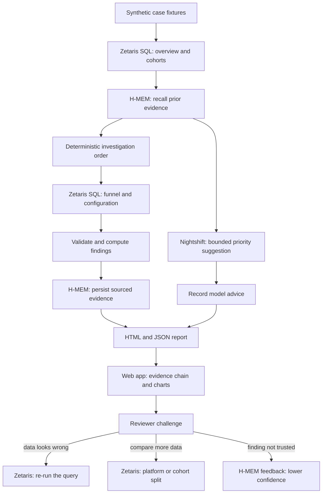

# LiveOps Investigator

**Investigate a game revenue drop with queryable evidence, bounded model advice, and memory that is checked against new facts.**

Local prototype for Open Agent Hackathon 2026, track **The Agent That Can Explain Why**.

## What it does

More players does not always mean more revenue. LiveOps Investigator runs two synthetic game-event investigations through real local services:

1. Query overview metrics and player cohorts through Zetaris.
2. Recall prior evidence from the official H-MEM TypeScript reference implementation.
3. Ask Nightshift for a constrained investigation-order suggestion.
4. Query payment funnels and event configuration through Zetaris.
5. Validate counts and compute evidence-based hypothesis checks.
6. Persist attributed evidence, reopen memory, and generate an auditable HTML report.

It runs as a local web app. The page states the question, streams each step of a live run, and shows every finding as a chain of evidence: the rule it was tested against, a chart, and the numbers behind it, each of which opens the SQL row it came from. A person can then challenge any part of the analysis, and the agent answers with new evidence (see [Use the web app](#use-the-web-app)).

The current workflow uses deterministic routing and calculations. Nightshift advises on priorities; it does not generate SQL, control execution, or establish causality. No successful result is fabricated when a service fails.

## Two cases

| Case | Observations | Supported next investigation |
| --- | --- | --- |
| Payment incident | Participants 1,000 → 1,500; revenue 1,000 → 900; payment success 80% → 60%; configuration unchanged | Inspect payment errors and device/version segments |
| Offer regression | Participants 1,500 → 1,800; revenue 1,200 → 800; payment success remains 80%; reward units 100 → 60 | Investigate offer changes and validate with a controlled comparison |

Case two recalls case one and checks payments first. Fresh evidence rejects a repeat payment-success decline. This demonstrates memory-guided investigation without blindly copying a historical conclusion. Both checks always run; no latency or query-count improvement is claimed.

## Architecture



## Requirements

- Node.js 22+ (tested with 24.14.0) and npm.
- A running, licensed Zetaris deployment with its web API available locally. Obtain the software and credentials through [Zetaris](https://github.com/zetaris/getting-started); proprietary installers and credentials are not included.
- A running [Nightshift](https://meterless.ai/windows.html) installation with a local model ready. Tested with Nightshift 1.2.7, `meterless/local`, and Llama 3.2 1B Instruct.
- Windows is the tested environment. H-MEM is vendored and needs no separate service.

## Quick start

```powershell
npm ci
Copy-Item .env.example .env.local
# Edit .env.local with your own local Zetaris credentials.
# Do not overwrite an existing configured .env.local.
npm test
npm run verify -- --chat
npm run app
```

`npm run app` serves the web app at `http://127.0.0.1:4317/` (set `APP_PORT` to change it); open it and click **Run the investigation**. On Windows, double-click **Run-App.cmd** to start it and open the browser. `npm run demo` runs the same investigation in the terminal and writes `reports/demo.html`; **Run-Demo.cmd** runs that and opens the report. The launcher expects dependencies and services to be ready; it does not install or start them.

Configuration:

| Variable | Purpose |
| --- | --- |
| `ZETARIS_BASE_URL` | Web origin, such as `http://127.0.0.1:3000` |
| `ZETARIS_USERNAME`, `ZETARIS_PASSWORD` | Your local deployment login |
| `ZETARIS_API_KEY`, `ZETARIS_ORG_ID` | Alternative token and organization authentication |
| `NIGHTSHIFT_BASE_URL` | Local provider, default `http://127.0.0.1:8088/v1` |
| `NIGHTSHIFT_MODEL` | Routing mode; example defaults to `meterless/local` |
| `NIGHTSHIFT_TOKEN` | Optional override; Windows otherwise reads the current user's runtime `proxy-token` file |

Login credentials take precedence over the token alternative. H-MEM persistence is under `.state/replays/<run timestamp>`. Each demo starts a fresh replay; case two reopens the same store created by case one. This avoids contamination by future cases from earlier replays.

## Use the web app

Each case reads top to bottom:

1. **Finding**, in plain words, derived from the checks below it. It says where to look next, not what caused the drop.
2. **The symptom**: players, paying players, and revenue before and after the event.
3. **Where it looked first, and why**: the records H-MEM recalled, the routing rule, the order actually run, and Nightshift's advisory suggestion.
4. **Testing each explanation**: payment success against the five-point rule, and a before/after diff of the event offer, each with a verdict. Every number is a link to its source row.
5. **Consistency checks**: cohort totals and payment counts that had to reconcile for the run to continue.
6. **Reviews and follow-up checks**, then the full list of SQL executed.

Challenges are recorded per run in `reports/<run>.reviews.json`:

| Challenge | What the agent does |
| --- | --- |
| The data looks wrong (on a check, or on one number from the evidence panel) | Re-runs the query on Zetaris and reports whether the source still returns the recorded rows. Everything that rests on that query is marked "data disputed". |
| Something is missing | Runs another comparison as a new Zetaris query: payment success by platform (which must add up to the payment funnel) or conversion by player cohort. |
| I don't trust this | Marks the finding disputed and calls H-MEM `feedback(id, 'wrong')` on the evidence stored for that case, which lowers its confidence by 0.2, tags it `review`, and logs the change in the H-MEM ledger. |

A challenged finding stays flagged until its reviews are marked resolved. The server listens only on `127.0.0.1` and rejects requests from other origins.

## Inspect the evidence

The report includes each executed SQL statement, returned rows, timing, model routing suggestion, memory provenance, and deterministic findings. All report text, logs, and docs are in English.

Fixtures are SQL CTEs evaluated by Zetaris, not production tables or persistent data-source integrations. Counts assume at most one purchase attempt per player per period. Payment successes must equal payers, and cohort totals must reconcile with overview metrics. A decline exceeding five percentage points flags a payment-success issue; this is a demonstration rule, not a significance test.

## Validation and limitations

Twenty-four automated tests cover the evidence chain (every number traced to its query, period, and column; findings that must agree with the computed verdicts), challenge validation and status, the platform split's reconciliation, metric handling, rejection of blank, non-numeric, or version-less evidence, model-reply validation, cohort and payment-count reconciliation, the memory-routing rule, endpoint normalization, and authentication behavior. Both cases have also completed with actual Zetaris, Nightshift, and H-MEM calls on the development machine. Tests alone do not establish live-service availability; use `npm run verify -- --chat` and `npm run demo` for that.

A 1B model produced incorrect metric explanations during development. Consequently, model output is constrained to two allowed priority IDs and is validated; numerical findings come from code. Invalid model output fails the run. Model suggestions are advisory, and the supplied examples do not establish general model quality.

Configuration changes can coincide with conversion changes without causing them. No production root cause, automated remediation, arbitrary natural-language querying, or causal inference is claimed. Service failures produce a nonzero exit code; an existing report may remain, so check its timestamp.

## Repository map

- `src/app.ts`, `web/`: local web app (server, page, charts)
- `src/pipeline.ts`: the two-case investigation, shared by the web app and `src/workflow.ts` (terminal)
- `src/evidence.ts`: derivation shown on the page, with a source reference for every number
- `src/review.ts`, `src/review-actions.ts`: reviewer challenges and the agent's follow-up queries
- `src/cases.ts`: fixtures, SQL, validation, and memory routing
- `src/providers.ts`: Zetaris and Nightshift adapters
- `src/workflow-report.ts`: report renderer
- `src/*.test.ts`: automated tests
- `vendor/hmem/`: upstream H-MEM reference and license
- `docs/PROJECT-INTRO.md`: submission description and project positioning
- `docs/DEMO-SCRIPT.md`: timed English video script
- `docs/RELEASE-CHECKLIST.md`: preparation and remaining manual steps

Legacy single-case code remains available through `npm run demo:legacy`.

## Sponsor technology

- **Zetaris** is the data layer. Every piece of evidence in the report is a SQL statement executed through the Zetaris web API with login authentication, and the report shows each statement, its returned rows, and its timing. The game data is inline SQL fixtures, not a connected production source.
- **Meterless Nightshift** is the AI provider. The workflow calls its local OpenAI-compatible endpoint with the `meterless/local` routing mode for a constrained investigation-priority suggestion.
- **Meterless H-MEM** is the memory engine. Each case stores attributed evidence, and the next case reopens the store from disk to choose its query order before fresh evidence is checked. When a reviewer rejects a finding, H-MEM's feedback API lowers the confidence of the stored evidence and records the change in its ledger.
- **NVIDIA:** the local model, Llama 3.2 1B Instruct, runs under Nightshift on an NVIDIA RTX 4060 Laptop GPU through CUDA. NVIDIA Nemotron is not used.
- **Cursor** was used as the code editor during development. It is not part of the running workflow.
- **What is distinctive:** memory changes where the investigation looks first, but it is never accepted as the answer. Case two follows the remembered payment lead, finds it contradicted by fresh evidence, and moves to the offer change instead.

Pre-existing components: the vendored H-MEM reference implementation. The first project commit is dated 2026-10-26, inside the build window.

## License and attribution

Original project code is released under the MIT License; see `LICENSE`. H-MEM source is from [Meterless/Meterless](https://github.com/Meterless/Meterless), commit `1742dec56a66e58eef9dda2d2b865823758ca8cd`, path `engines/hmem/reference/src`; it remains under the Apache License 2.0 in `vendor/hmem/LICENSE`. Zetaris and Nightshift are external products and are not redistributed here.

Local credentials, private notes, runtime memory, generated reports, dependencies, and installers are excluded from Git. Do not upload local `.env` files or registry credentials.
